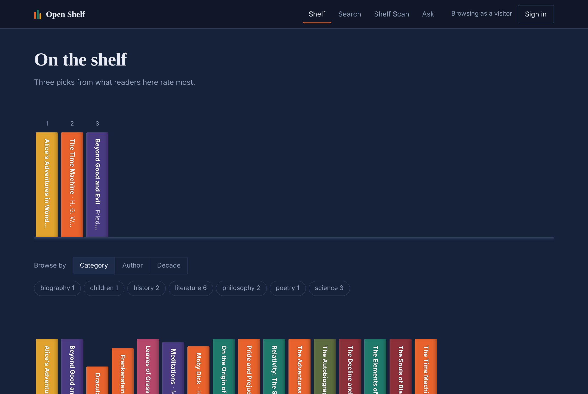

# Open Shelf

[](https://github.com/USERNAME/open-shelf/actions/workflows/ci.yml)


A free library of technology books. It imports **2,465 freely available
titles** from open catalogues, lets you search and browse them, answers
questions about them from its own files, and recognises books from a
photograph of your bookshelf.

The face recogniser, the image descriptor and the search ranking are written
here in numpy. No ML framework does the interesting part.



---

## Run it

```bash
docker compose up --build
```

Then open **http://localhost:8000/app/** — that starts PostgreSQL, applies the
migrations, seeds the demo library and serves the app. The API documents
itself at `/docs`.

<details>
<summary>Without Docker</summary>

```bash
pip install -r requirements.txt
export DATABASE_URL="sqlite:///shelf.db"
export JWT_SECRET="$(python -c 'import secrets; print(secrets.token_urlsafe(48))')"

alembic upgrade head
python tools/seed_db.py                        # demo library and accounts
python tools/import_resources.py free-programming-books   # 2,465 real resources
python -m bookstore.api
```
</details>

Sign in as `margaret` / `admin123` for the management views, or `carol` /
`carol123` to see a trusted contributor's double-weighted ratings.

---

## The three problems worth reading about

**Two people bought the last copy.** When this was a shop, checkout checked
stock and then decremented it, with nothing making those two steps atomic.
Measured on PostgreSQL with sixteen simultaneous checkouts:

| | Orders paid |
|---|---|
| No row lock | **9 of 16** |
| `SELECT … FOR UPDATE` | 1 of 16 |

`CHECK (stock >= 0)` does *not* fix this, and it is worth knowing why: in a
lost update every session reads 1 and writes 0, so no row goes negative and
the constraint never fires. Preserved at the `v1.0-coursework` tag and in
[ADR-001](docs/adr/ADR-001-postgresql-and-web-only.md).

**Importing the same catalogue twice.** The importer runs on a schedule and
sometimes overlaps a manual run. Measured with eight importers starting
together — and the obvious summary is wrong:

| | Duplicates | Importers that crashed |
|---|---|---|
| Check-then-insert | 0 | **7 of 8** |
| `INSERT … ON CONFLICT DO UPDATE` | 0 | 0 |

The unique constraint is what makes duplication impossible. The upsert is
what makes *losing the race survivable*. Two mechanisms, two different
failures. A re-import of an unchanged catalogue writes nothing: 2,465
inserted on the first run, 2,465 unchanged on the second.

**Search that stops working at scale.** `ILIKE '%term%'` cannot use a B-tree
index at any size. Grown to 101,065 rows and measured:

| | Time |
|---|---|
| `ILIKE` | 239.5 ms, discarding 99,507 rows |
| `tsvector` + GIN index | **2.0 ms**, same 1,558 results |

118× for a 2.9 MB index. The full analysis, including a scaling problem that
turned out not to be real, is in [SYSTEM_DESIGN.md](docs/SYSTEM_DESIGN.md).

---

## What it does

| | |
|---|---|
| **Imports real catalogues** | 2,465 resources from free-programming-books (CC-BY-4.0), idempotently, with every run audited |
| **Search and browse** | TF-IDF keyword search, topic and language facets, 269 topics |
| **Face sign-in** | Enrol from the browser camera, then sign in by looking at it. Eigenfaces in numpy |
| **Picture search** | Hand it a photo of a cover; it finds the book |
| **Shelf Scan** | Photograph a bookshelf. It segments the image, names each book and recommends more |
| **Assistant** | Answers from the catalogue or from local files via RAG, and always says which |
| **Moderated reviews** | Taboo words masked; more than three blocks the comment and earns a warning; three warnings suspends the account |
| **Earned standing** | Three reviews that pass moderation make you a trusted contributor, whose ratings count double |
| **SQL reporting** | CTEs, window functions and deliberate outer joins in the management views |

---

## Architecture

Business rules live in `bookstore/services/` and nowhere else. The HTTP layer
is transport; the browser client is a view.

```
  Browser (vanilla JS)  →  FastAPI  →  services/  →  SQLAlchemy  →  PostgreSQL
                                           ↑
                        bookstore/ingest/ (importers, same rules)
```

| | |
|---|---|
| **Language** | Python 3.11–3.12, JavaScript, SQL |
| **API** | FastAPI · Pydantic · uvicorn — 40 paths |
| **Database** | PostgreSQL · SQLAlchemy 2 · Alembic. Runs on SQLite too |
| **Auth** | JWT access tokens + rotating refresh tokens with reuse detection; PBKDF2 passwords |
| **ML / CV** | numpy and OpenCV. Eigenfaces, TF-IDF and the image descriptor are implemented here, not imported |
| **Testing** | pytest — 149 tests against both databases |
| **CI/CD** | GitHub Actions — tests, migration drift check, conformance, lint, Docker |

Deeper: [ARCHITECTURE.md](ARCHITECTURE.md) ·
[SYSTEM_DESIGN.md](docs/SYSTEM_DESIGN.md) · [ADR-001](docs/adr/ADR-001-postgresql-and-web-only.md) ·
[ADR-002](docs/adr/ADR-002-free-resource-platform.md)

---

## Tests

```bash
pytest tests/                                    # 148 passing, 1 skipped
TEST_DATABASE_URL=postgresql+psycopg://… pytest  # 149 passing
python tools/verify_features.py                  # 10 of 10 features
```

`test_ingest_pipeline.py` includes a concurrency test that runs six importers
at once and asserts the catalogue neither duplicates nor crashes.
`test_integration.py` runs one long session and then audits it: reported
figures must match the rows behind them, every warning must have an event
recording it, and no account may hold a state the rules say cannot exist.

---

## Known limitations

Stated here rather than left to be found.

- **No rate limiting.** Passwords are PBKDF2 over 120,000 rounds, but nothing
  stops an attacker trying.
- **No accuracy figure is claimed for face recognition.** It is verified end
  to end with synthetic faces and a simulated camera. That proves the
  pipeline, not a number for real faces.
- **Links are not yet health-checked.** 2,465 URLs point at other people's
  servers and will decay. The checker is designed but not built.
- **The LLM fallback needs Ollama running locally.** Without it, questions are
  still answered from the knowledge base and the app says the model is offline.
- **`CORS_ORIGINS` defaults to `*`.** Fine for a local demo; name your origin
  before deploying.

## Attribution

Catalogue data from the
[free-programming-books](https://github.com/EbookFoundation/free-programming-books)
project by the Free Ebook Foundation, used under CC BY 4.0. Nothing is
mirrored here — every resource links to whoever publishes it.

## License

MIT — see [LICENSE](LICENSE).
