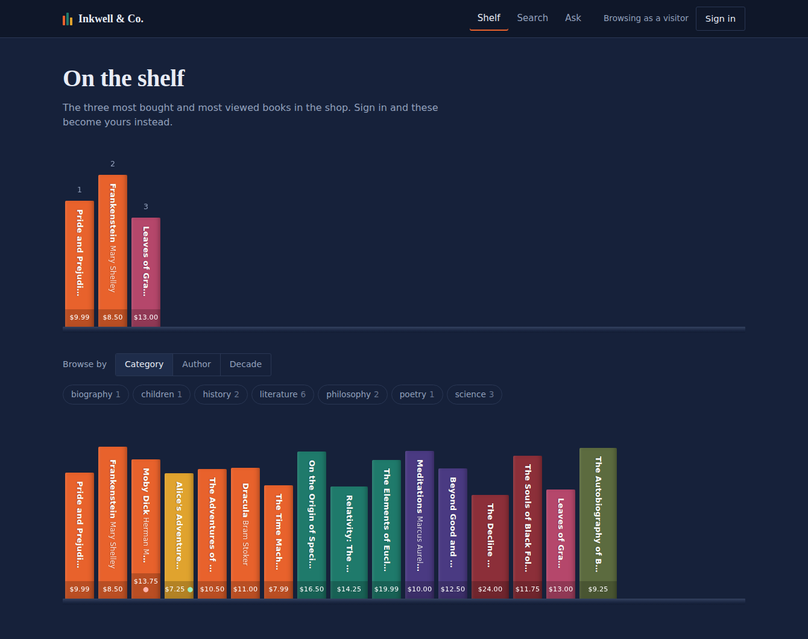
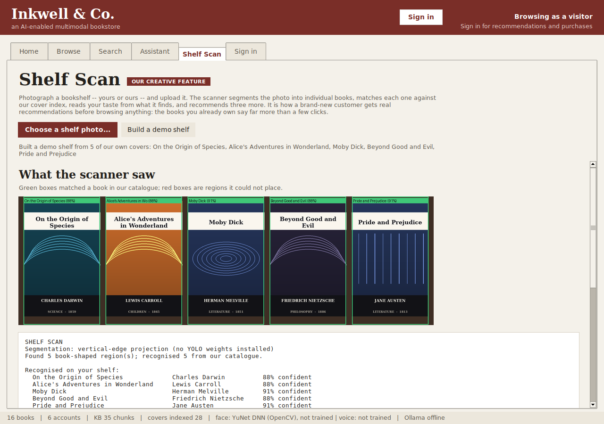
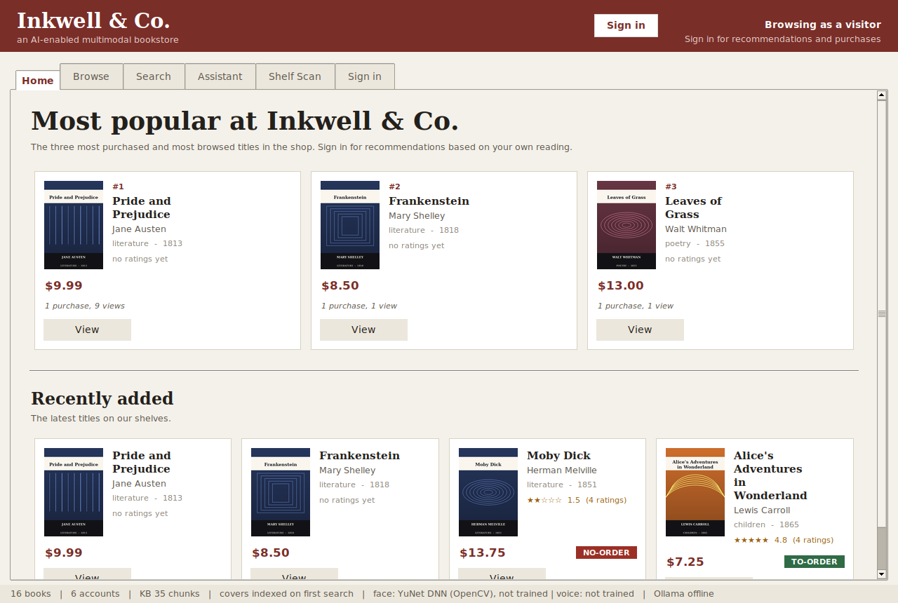
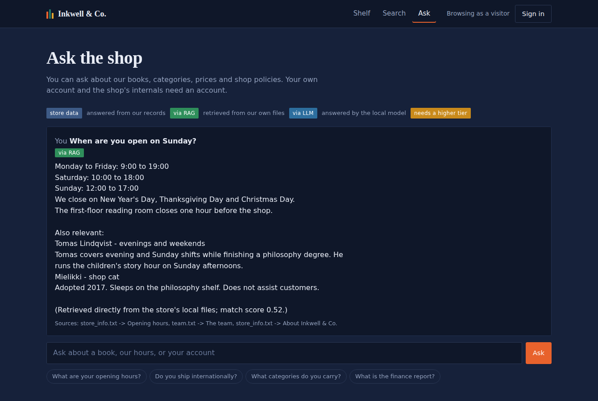
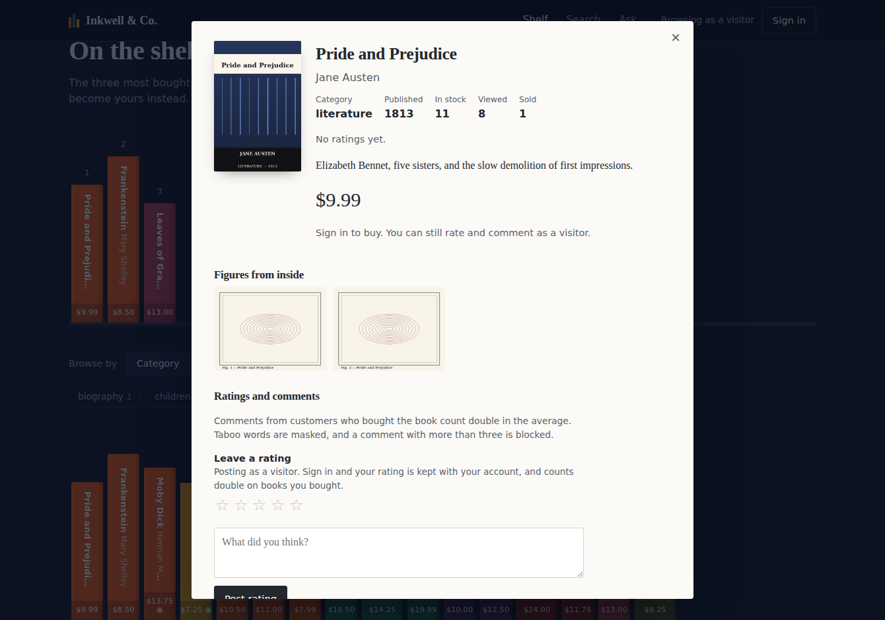
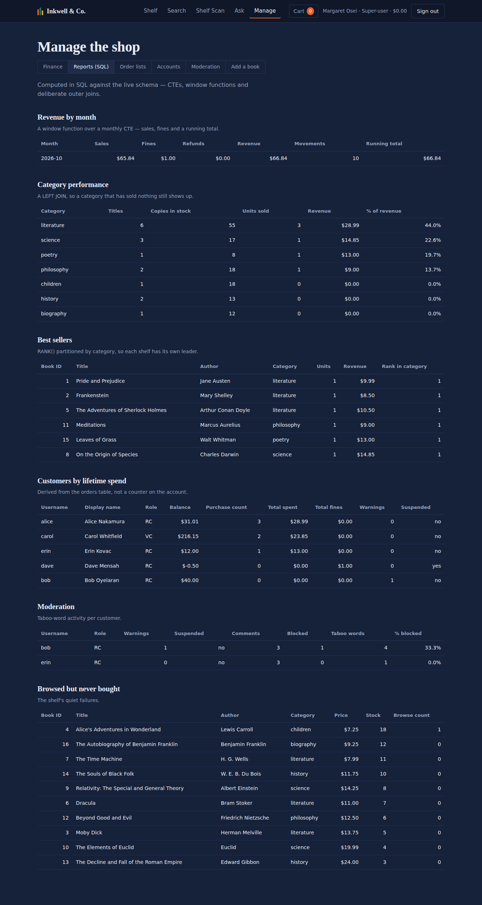

# Inkwell & Co. — an AI-enabled multimodal smart bookstore

[](https://github.com/USERNAME/smart-bookstore/actions/workflows/ci.yml)


A bookstore with four privilege tiers, **face-recognition login**, keyword *and*
picture search, moderated reviews, a role-tiered assistant backed by RAG and a
local LLM, and a feature that reads your taste from a photograph of your
bookshelf.

Two clients, one rules engine: a **Tkinter desktop app** and a **FastAPI + web
client**. No paid API, no cloud service, no third-party ML framework doing the
interesting parts — the face recogniser, the speaker recogniser, the image
descriptor and the retrieval are all written here, in numpy.

<p align="center">
  
</p>

---

## Contents

- [Quick start](#quick-start) · [Docker](#docker)
- [What it does](#what-it-does)
- [Screenshots](#screenshots)
- [Architecture](#architecture) · [Tech stack](#tech-stack)
- [The interesting problems](#the-interesting-problems)
- [Tests](#tests)
- [Troubleshooting](#if-something-does-not-work)

---

## Quick start

```bash
pip install -r requirements.txt
python tools/seed.py          # 16 books, 6 accounts, covers, reviews
```

Then run **either** client — they share the same data and the same rules.

```bash
python run.py                 # the desktop app (Tkinter)
python -m bookstore.api       # the web app  -> http://localhost:8000/app/
```

The API documents itself at `http://localhost:8000/docs`.

If Tkinter is missing: `sudo apt install python3-tk` (Debian/Ubuntu),
`brew install python-tk` (macOS), or reinstall Python with *tcl/tk and IDLE*
ticked (Windows). The web client needs no Tkinter at all.

### Docker

```bash
docker build -t smart-bookstore .
docker run --rm -p 8000:8000 smart-bookstore
```

The image serves the web client with a demo shop already seeded. It
deliberately does not run the desktop client: a GUI needs a display, and
shipping one inside a container to run a window nobody can see would be
theatre.

### Optional extras

```bash
python tools/fetch_models.py            # better face detection (YuNet, ~230 KB)
python tools/seed.py --gutenberg        # real public-domain texts from gutenberg.org
python tools/seed.py --demo-biometrics  # synthetic face samples, no camera needed
```

For the assistant's general-knowledge fallback, install
[Ollama](https://ollama.com), then `ollama serve` and `ollama pull llama3.2`.
Without it, shop questions still work — they are answered by RAG from local
files — and the app says the LLM is offline rather than failing silently.

### Demo accounts

| Username   | Password   | Role              | Why it's interesting                        |
|------------|------------|-------------------|---------------------------------------------|
| `margaret` | `admin123` | Super-user        | Finances, accounts, moderation, SQL reports  |
| `alice`    | `alice123` | Registered, $31   | 3 purchases — one more promotes her to VIP   |
| `carol`    | `carol123` | VIP, $216         | 10% discount applied everywhere              |
| `dave`     | `dave1234` | Registered, $0.50 | Try buying something: fine, then suspension  |
| `bob`      | `bob12345` | Registered        | Already has a warning from a blocked comment |
| `erin`     | `erin1234` | Registered        | Has a masked (not blocked) comment           |

In the web client the demo rows sign you straight in, so you can switch tiers
in one click and watch the same page change.

### Your face is your login

Creating an account in the desktop client **takes five photographs** and trains
the recogniser on them. From then on that account signs in by looking at the
camera, and the password is refused — the requirement says customers log in
with a face.

Two deliberate exceptions, both switchable in `config/settings.json`:

- **The super-user keeps password access** (`super_user_password_bootstrap`),
  because somebody has to get in before any face exists. The moment the
  super-user enrols a face, that exemption stops applying to them.
- **The seeded demo accounts have no face**, so they still take a password.
  Enrol one and it becomes face-only.

Set `require_face_enrolment` and `require_face_login` to `false` to turn the
whole thing off.

**macOS camera permission:** the first time the camera opens, macOS asks
Terminal for access. If you miss the prompt, enable Terminal under **System
Settings → Privacy & Security → Camera**, then fully quit Terminal (⌘Q) and
reopen it.

---

## What it does

| | |
|---|---|
| **Four privilege tiers** | Visitor, registered customer, VIP, super-user. Privilege changes prices, recommendations, and how much the assistant will tell you. |
| **Face and voice login** | Eigenfaces (PCA + nearest neighbour) and MFCC speaker ID, both written in numpy. |
| **Keyword search** | TF-IDF over titles, authors, descriptions and full book texts, with a stemmer. |
| **Picture search** | Hand a photo of a cover or an internal figure; it finds the book. |
| **Shelf Scan** | Photograph a bookshelf. It segments the photo, names each book, reads your taste and recommends three more. |
| **Moderated reviews** | Taboo words masked; more than three blocks the comment and earns a warning; three warnings suspends the account. |
| **Weighted ratings** | A comment from someone who actually bought the book counts double. |
| **Order lists** | More than three ratings, weighted average below 2 or above 4, lands a title on the no-order or to-order list. |
| **Role-tiered assistant** | Answers from shop records, from RAG over local files, or from a local LLM — and always says which. |
| **Finance and SQL reports** | Every figure traced to the transaction ledger, plus reports computed in SQL. |

---

## Screenshots

**Shelf Scan — the creative feature.** Segment a shelf photo, match each region
against the cover index, and recommend from what it finds.



**The desktop client.**



**The assistant, answering from local files and citing them.**



**A book, with figures, weighted ratings and tier-aware pricing.**



**Reports, computed in SQL.**



---

## Architecture

The rule is that **business rules live in exactly one place**. Both clients are
transport over the same engine; neither contains a rule of its own. That was
not a refactor — it is why adding a web client meant writing HTTP handlers and
nothing else.

```
                 ┌──────────────────┐     ┌────────────────────────┐
                 │  Tkinter client  │     │  Web client (vanilla)  │
                 │   bookstore/ui   │     │         web/           │
                 └────────┬─────────┘     └───────────┬────────────┘
                          │                           │ fetch()
                          │                ┌──────────▼───────────┐
                          │                │  FastAPI             │
                          │                │  bookstore/api       │
                          │                └──────────┬───────────┘
                          └───────────┬───────────────┘
                                      │
              ┌───────────────────────▼────────────────────────┐
              │  Domain: rules, catalog, recommend, moderation │
              │  biometrics, imagesearch, shelfscan, rag, chat │
              └───────────────────────┬────────────────────────┘
                                      │
                       ┌──────────────▼──────────────┐
                       │  storage.py — atomic JSON   │
                       │  data/*.json  (the record)  │
                       └──────────────┬──────────────┘
                                      │ projected, never written back
                       ┌──────────────▼──────────────┐
                       │  analytics.py — SQLite      │
                       │  reports only, disposable   │
                       └─────────────────────────────┘
```

**Why text files and not a database.** The specification requires it. So
`data/*.json` is the system of record: atomic writes (`.tmp` + `os.replace`),
corrupt files preserved as `.corrupt` rather than silently discarded.

**Then why is there SQL?** Because "revenue by category by month, with each
category's running total and its rank" is one readable query in SQL and a
tangle of nested dictionaries in Python. `bookstore/analytics.py` projects the
text files into a throwaway SQLite database, runs the reports, and throws it
away. Nothing is ever written back; deleting the projection loses nothing. The
projection refuses anything that is not a `SELECT`, and holds no password
hashes. `tests/test_analytics.py` asserts the SQL agrees with `rules.py` — same
weighted averages, same order-list classification, same totals — so the two
cannot drift apart unnoticed.

### Tech stack

| | |
|---|---|
| **Language** | Python 3.9 – 3.12 (16,300 lines), JavaScript (914 in the web client, 1,300 in the SRS generator), CSS (590), HTML (198) |
| **Desktop UI** | Tkinter / ttk — standard library, no framework |
| **Web API** | FastAPI + Pydantic + uvicorn — 27 routes, OpenAPI docs |
| **Web client** | Vanilla JS, no build step, no dependencies |
| **ML / CV** | numpy and OpenCV. Eigenfaces, MFCCs, TF-IDF and the image descriptor are implemented here, not imported |
| **Reporting** | SQLite — CTEs, window functions, views |
| **Storage** | Atomic JSON text files |
| **LLM** | Ollama over `urllib` (standard library only) |
| **Testing** | `unittest`, xvfb for headless GUI tests, `TestClient` for HTTP |
| **CI/CD** | GitHub Actions — tests on two Python versions, lint, API boot, Docker build |

---

## The interesting problems

**OpenCV 5 removed the thing everyone uses.** `cv2.face.LBPHFaceRecognizer`,
`cv2.CascadeClassifier` and the bundled Haar cascades are gone. So the face
recogniser is eigenfaces written here: crop, histogram-equalise, 96×96,
mean-centre, PCA by SVD, nearest neighbour in the subspace, with a confidence
threshold that rejects strangers. Detection falls back YOLO → YuNet DNN → Haar
(4.x only) → centre crop, and reports which one it used.

**A camera that lies about being open.** On macOS, OpenCV defaults to the
FFMPEG backend, which cannot enumerate an AVFoundation webcam — and
`isOpened()` returns `True` anyway. `cameras.py` names the platform's backend
explicitly, then proves the camera works by reading an actual frame before
believing it. Denied camera permission looks identical to a missing camera
until you try to read.

**"What is the capital of Mongolia?" was being answered from the shop's FAQ.**
The question scored just high enough on filler words. Retrieval now requires
the best chunk to clear a similarity threshold **and** share a rare term with
the corpus — rare meaning it appears in at most a third of chunks.

**Shelf Scan kept cutting books in half.** Edge projection mistook cover
artwork for the gap between books: 12 of 19, with 3 false positives. The fix
was to stop looking for edges first — separate books from shelf background by
per-column detail, *estimate how many books a block contains* from the expected
cover aspect ratio, and only then cut. 19/19, no false positives.

**A window that hung instead of crashing.** Background workers finished by
calling `after()` from their own thread, which Tk does not allow. It raised,
the exception was swallowed, and the result was dropped — so the spinner never
stopped and the app looked frozen. A thread-safe queue drained on the Tk thread
replaced it; `tests/test_worker_dispatch.py` keeps it that way. It was found by
trying to screenshot the app for this README.

The four places the specification contradicted itself, and the reading taken
for each, are documented in [ARCHITECTURE.md](ARCHITECTURE.md) and switchable
under `spec_interpretation` in `config/settings.json`.

---

## Tests

```bash
python -m unittest discover -s tests     # 198 tests
python tools/verify_spec.py              # 35 live checks against the spec
```

Use `xvfb-run -a python -m unittest discover -s tests` on a headless machine,
or the GUI tests skip themselves — and a skipped test is not a passing one, so
CI fails the build if Tkinter is missing on the primary Python version.

| Suite | What it is for |
|---|---|
| `test_rules.py` | Every numbered requirement, in isolation. |
| `test_integration.py` | One long realistic session, then audited like a shop's books: the finance report must reconcile with the ledger, stock must be conserved, no account may hold an impossible state. Catches two individually correct rules that disagree about the same number. |
| `test_api.py` | The HTTP contract: status codes, privilege on every admin route, and that no response anywhere contains a password hash. |
| `test_analytics.py` | That the SQL agrees with the rules engine, and stays a projection. |
| `test_cameras.py` | Camera opening against fake devices, including the two failures that actually broke this on a real Mac. |
| `test_face_flow.py` | The whole biometric journey against a simulated webcam, including the case where the camera never opens and no account should be created. |
| `test_worker_dispatch.py` | That a result from a background thread reaches the window. |

`verify_spec.py` is a conformance check rather than a test: it builds a
throwaway store, exercises each of the specification's fourteen items the way a
grader would, and prints the evidence beside each one. A passing unit suite
proves the code does what the tests say; this proves the tests say what the
specification says. See [REQUIREMENTS_AUDIT.md](REQUIREMENTS_AUDIT.md) for the
item-by-item writeup.

---

## What's where

```
smart_bookstore/
├── run.py                      the desktop client
├── Dockerfile                  the web client, containerised
├── .github/workflows/ci.yml    tests, lint, API boot, Docker build
├── ARCHITECTURE.md             design, traceability, known limits
├── REQUIREMENTS_AUDIT.md       every spec item, checked against the code
├── config/settings.json        every tunable rule and the 4 interpretation flags
├── bookstore/
│   ├── storage.py              atomic JSON text-file repository
│   ├── models.py               records, roles, PBKDF2 password hashing
│   ├── rules.py                THE BUSINESS RULES
│   ├── moderation.py           taboo masking and blocking
│   ├── catalog.py              browse, keyword search, stemming
│   ├── recommend.py            top-3 by role
│   ├── imagesearch.py          picture search
│   ├── biometrics.py           face + voice enrol / train / identify
│   ├── cameras.py              reliable camera opening
│   ├── rag.py                  TF-IDF retrieval over data/kb/
│   ├── llm.py                  Ollama client (urllib only)
│   ├── chat.py                 role tiering + RAG/LLM routing
│   ├── finance.py              the super-user's finance report
│   ├── analytics.py            SQL reporting over a disposable projection
│   ├── shelfscan.py            the creative feature
│   ├── api/                    FastAPI app, Pydantic schemas
│   └── ui/                     Tkinter views
├── web/                        the browser client (3 files, no build step)
├── data/                       the system of record, plus covers and the RAG corpus
├── tools/
│   ├── seed.py                 demo data, covers, Gutenberg download
│   ├── check_camera.py         diagnose a camera that will not work
│   └── verify_spec.py          walk the spec against running code
└── tests/
```

---

## If something does not work

| Symptom | Cause and fix |
|---|---|
| `Tkinter is not available` | Install the OS package — see Quick start. Or use the web client, which needs no Tkinter. |
| **Anything camera-related** | Run `python tools/check_camera.py` first — it names the cause instead of guessing. |
| Camera window cannot open | macOS: System Settings → Privacy & Security → Camera → enable Terminal, then ⌘Q Terminal and reopen. Also close Zoom/FaceTime/Photo Booth. |
| "No face has been enrolled yet" | Correct — nobody has enrolled. Create an account, which enrols you. |
| Preview says "Looking for your face…" | Move closer, face the camera straight on, and put the light in front of you, not behind. |
| Cannot sign in with a password | That account has a face enrolled, so it is face-only by design. Use *Use camera*, or set `require_face_login: false`. |
| Face login says "centre crop" | `python tools/fetch_models.py` |
| Picture search tab disabled | `pip install numpy Pillow` |
| `python -m bookstore.api` fails | `pip install -r requirements.txt` — the web layer needs fastapi and uvicorn. |
| Assistant says the LLM is offline | `ollama serve`, then `ollama pull llama3.2`. Shop questions still work. |
| Store is empty | `python tools/seed.py` |
| Want to start over | `python tools/seed.py --reset` |

---

## License

MIT — see [LICENSE](LICENSE).
