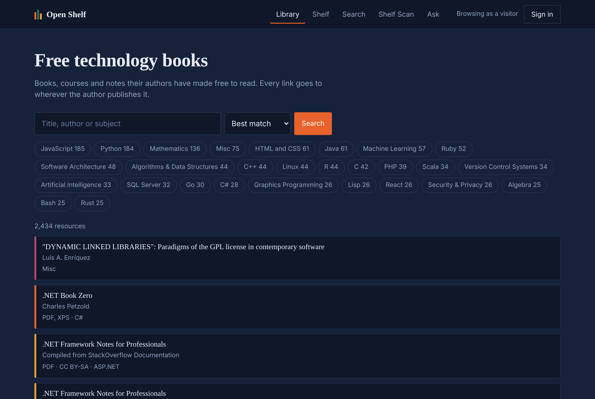

# Open Shelf

**Live: [open-shelf-1qsl.onrender.com](https://open-shelf-1qsl.onrender.com/app/)**
— demo accounts: `margaret` / `admin123` (administrator), `alice` / `alice123`
(member), `carol` / `carol123` (trusted contributor).

[](https://github.com/Riyad291/open-shelf/actions/workflows/ci.yml)


A free library of technology books. It imports **2,434 freely available
titles** from open catalogues, lets you search and browse them, answers
questions about the site from its own files, and recognises books from a
photograph of your bookshelf.

The face recogniser, the image descriptor and the search ranking are written
here in numpy. No ML framework does the interesting part.



---

## Run it

```bash
docker compose up --build
```

Then open **http://localhost:8000/app/** — that starts PostgreSQL, applies the
migrations, seeds the demo library and serves the app. The API documents
itself at `/docs`.

<details>
<summary>Without Docker</summary>

```bash
pip install -r requirements.txt
export DATABASE_URL="sqlite:///shelf.db"
export JWT_SECRET="$(python -c 'import secrets; print(secrets.token_urlsafe(48))')"
export LLM_API_KEY="..."     # optional; free key at https://console.groq.com

alembic upgrade head
python tools/seed_db.py                        # demo library and accounts
python tools/import_resources.py free-programming-books   # 2,434 real resources
python -m bookstore.api
```
</details>

Sign in as `margaret` / `admin123` for the management views, or `carol` /
`carol123` to see a trusted contributor's double-weighted ratings.

<details>
<summary>Deploy it</summary>

`render.yaml` describes the service, so the deployment is reviewable and
repeatable rather than a set of remembered dashboard clicks.

1. Create a free PostgreSQL database at [neon.tech](https://neon.tech) and
   copy its connection string.
2. On [render.com](https://render.com): **New → Blueprint**, point it at this
   repository. It reads `render.yaml`.
3. Set two secrets in the dashboard: `DATABASE_URL` (from Neon, with
   `postgresql+psycopg://` as the scheme) and, optionally, `LLM_API_KEY`.
   `JWT_SECRET` is generated for you and kept across deploys.

`tools/start.py` is the entrypoint. On every boot it migrates, seeds the demo
shelf if the database is empty, imports the catalogue if it is short, and
redraws any cover images the container has lost — a free tier has no
persistent disk, so the rows survive a restart and the PNGs do not. Each step
checks before it acts, so a restart with nothing to do costs one query.

</details>

---

## The three problems worth reading about

**Two people bought the last copy.** When this was a shop, checkout checked
stock and then decremented it, with nothing making those two steps atomic.
Measured on PostgreSQL with sixteen simultaneous checkouts:

| | Orders paid |
|---|---|
| No row lock | **9 of 16** |
| `SELECT … FOR UPDATE` | 1 of 16 |

`CHECK (stock >= 0)` does *not* fix this, and it is worth knowing why: in a
lost update every session reads 1 and writes 0, so no row goes negative and
the constraint never fires. Preserved in [the desktop version](https://github.com/Riyad291/open-shelf/tree/2e6cc23) and in
[ADR-001](docs/adr/ADR-001-postgresql-and-web-only.md).

**Importing the same catalogue twice.** The importer runs on a schedule and
sometimes overlaps a manual run. Measured with eight importers starting
together — and the obvious summary is wrong:

| | Duplicates | Importers that crashed |
|---|---|---|
| Check-then-insert | 0 | **35 of 40** |
| `INSERT … ON CONFLICT DO UPDATE` | 0 | 0 of 40 |

The unique constraint is what makes duplication impossible. The upsert is
what makes *losing the race survivable*. Two mechanisms, two different
failures. A re-import of an unchanged catalogue writes nothing: 2,434
inserted on the first run, 2,434 unchanged on the second.

**Search that stops working at scale.** `ILIKE '%term%'` cannot use a B-tree
index, because of the leading wildcard, so it reads every row. Grown to
99,794 rows and measured ("machine learning", median of five runs):

| | Time |
|---|---|
| `ILIKE` on three columns | 128–157 ms, sequential scan |
| `tsvector` + GIN index | **1.7–2.6 ms**, the same 1,558 rows |

Fifty to ninety times faster, for a 6.4 MB index. Matching words is also more
correct: `ILIKE '%rust%'` finds *Zero Trust Networks*. The analysis is in
[SYSTEM_DESIGN.md](docs/SYSTEM_DESIGN.md).

---

## What it does

| | |
|---|---|
| **Imports real catalogues** | 2,434 resources from free-programming-books (CC-BY-4.0), idempotently, with every run audited |
| **Search and browse** | PostgreSQL full-text search over 268 topics, plus TF-IDF search on the demo shelf |
| **Face recognition** | Eigenfaces in numpy: detect, align, PCA by SVD, nearest neighbour, and a threshold that lets it say "I don't know you". A demonstration, not the site's security -- see below |
| **Picture search** | Hand it a photo of a cover; it finds the book |
| **Shelf Scan** | Photograph a bookshelf. It segments the image, names each book and recommends more |
| **Assistant** | Answers from the database or from local help files via RAG, falls back to a hosted LLM, always says which, and is measured on 40 labelled questions |
| **Moderated reviews** | Taboo words masked; more than three blocks the comment and earns a warning; three warnings suspends the account |
| **Earned standing** | Three reviews that pass moderation make you a trusted contributor, whose ratings count double |
| **SQL reporting** | CTEs, window functions and deliberate outer joins in the management views |

---

## Architecture

Business rules live in `bookstore/services/` and nowhere else. The HTTP layer
is transport; the browser client is a view.

```
  Browser (vanilla JS)  →  FastAPI  →  services/  →  SQLAlchemy  →  PostgreSQL
                                           ↑
                        bookstore/ingest/ (importers, same rules)
```

| | |
|---|---|
| **Language** | Python 3.11–3.12, JavaScript, SQL |
| **API** | FastAPI · Pydantic · uvicorn — 40 paths |
| **Database** | PostgreSQL · SQLAlchemy 2 · Alembic. Runs on SQLite too |
| **Auth** | JWT access tokens + rotating refresh tokens with reuse detection; PBKDF2 passwords |
| **ML / CV** | numpy and OpenCV. Eigenfaces, TF-IDF and the image descriptor are implemented here, not imported |
| **LLM** | Any OpenAI-compatible API (Groq by default), called over plain `urllib` — no vendor SDK |
| **Testing** | pytest — 159 tests against both databases, plus an AI evaluation gate |
| **CI/CD** | GitHub Actions — tests, migration drift check, acceptance checks, AI evaluation, lint, Docker |

Deeper: [ARCHITECTURE.md](ARCHITECTURE.md) ·
[SYSTEM_DESIGN.md](docs/SYSTEM_DESIGN.md) · [ADR-001](docs/adr/ADR-001-postgresql-and-web-only.md) ·
[ADR-002](docs/adr/ADR-002-free-resource-platform.md)

---

## Tests

```bash
pytest tests/                                    # 155 passing, 4 skipped
TEST_DATABASE_URL=postgresql+psycopg://… pytest  # 159 passing
python tools/verify_features.py                  # 10 of 10 features
python tools/evaluate_ai.py                      # AI quality gate
```

`test_ingest_pipeline.py` includes a concurrency test that runs six importers
at once and asserts the catalogue neither duplicates nor crashes.
`test_integration.py` runs one long session and then audits it: reported
figures must match the rows behind them, every warning must have an event
recording it, and no account may hold a state the rules say cannot exist.

---

## Reproduce these numbers

Every figure above comes from a script in this repository, not from a note
someone took once. Each needs an empty PostgreSQL database it may overwrite.

```bash
# "7 of 8 importers crash" -- 8 importers, 5 trials each
python tools/bench_imports.py --database postgresql+psycopg://…

# search: ILIKE against the full-text index, at ~100k rows
python tools/bench_search.py --database postgresql+psycopg://… \
    --repo ../free-programming-books

# the assistant, on 20 covered and 20 uncovered questions
python tools/evaluate_ai.py
python tools/evaluate_ai.py --without-veto    # what the filter contributes

# every feature, driven over the real HTTP API
python tools/verify_features.py
```

Timings differ by machine; the ratios are the point. The AI figures are
exact, since the question sets are fixed.

| What | Measured here |
|---|---|
| Concurrent imports | check-then-insert 35 of 40 crashed; upsert 0 of 40 |
| Search at 99,794 rows | `ILIKE` 128–157 ms → full text 1.7–2.6 ms |
| Assistant recall | 85% of covered questions answered from the files |
| Assistant specificity | 80% of unrelated questions kept out (55% without the name filter) |
| Picture search | the right book ranked first for 10 of 10 covers |

---

## Known limitations

Stated here rather than left to be found.

- **No rate limiting.** Passwords are PBKDF2 over 120,000 rounds, but nothing
  stops an attacker trying.
- **Face recognition is a demonstration, not a security mechanism.** A
  photograph of an enrolled face passes, because there is no liveness check.
  It is verified end to end with synthetic faces and a simulated camera,
  which proves the pipeline and gives no honest number for real faces.
  Password sign-in is the real one, the administrator always keeps a
  password, and the samples can be deleted in one request. On the deployed
  demo the container's disk is wiped on restart, so an enrolment there lasts
  until the next one; the face panel says so before you use the camera.
- **Links are not yet health-checked.** 2,434 URLs point at other people's
  servers and will decay. The checker is designed but not built.
- **General-knowledge answers need an API key.** `LLM_API_KEY` reaches any
  OpenAI-compatible provider; the default is Groq's free tier. Without a key,
  questions about the site are still answered from its own files and the
  assistant says the model is not configured. There is no spend ceiling yet,
  which is the other half of the rate-limiting gap above.
- **`CORS_ORIGINS` defaults to `*`.** Fine locally; `render.yaml` names the
  real origin for the deployed site.
- **The deployed demo accounts are public**, including the administrator.
  That is deliberate — the management views are worth seeing — but it means
  anyone can delete a book. The catalogue re-imports itself on the next boot
  if it is emptied.
- **A free tier sleeps.** Render stops the container after 15 idle minutes.
  A [scheduled workflow](.github/workflows/keepalive.yml) requests a static
  page every 10 minutes to keep it up, and leaves the database free to sleep.
  GitHub sometimes runs schedules late, so a cold start can still happen.

## Attribution

Catalogue data from the
[free-programming-books](https://github.com/EbookFoundation/free-programming-books)
project by the Free Ebook Foundation, used under CC BY 4.0. Nothing is
mirrored here — every resource links to whoever publishes it.

## License

MIT — see [LICENSE](LICENSE).
